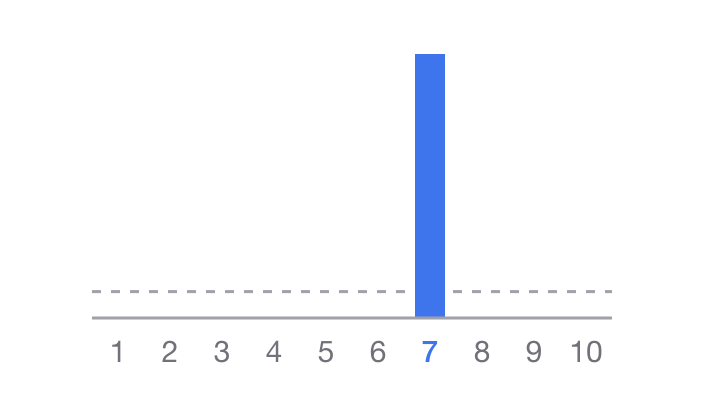
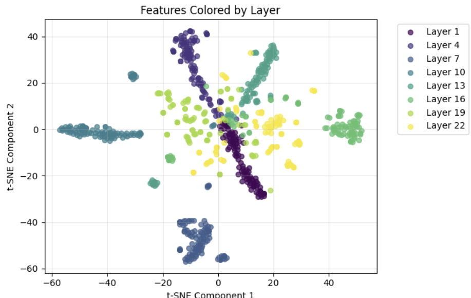

# Mechanistic Interpretability on Randomness in LLMs

**JAIST Summer 2025 Research Internship** · Chotpisit Adunsehawat · June–August 2025, Nomi, Japan

A joint Chulalongkorn University–JAIST project, advised by
**Kiyoaki Shirai** and **Natthawut Kertkeidkachorn** (JAIST) and
**Ekapol Chuangsuwanich** (Chulalongkorn University).
Presented at **JAIST–Thai Week**, 4 September 2025.

The project started as a hunt for **hidden or unfaithful chain-of-thought**: reasoning
models whose written reasoning doesn't reflect how they actually reached an answer. That
turned up plenty of odd cases, but they were hard to reproduce or generalise. The
clearest thread was **randomness**: ask a model for a random number and it is anything
but random. The final weeks used **sparse autoencoders and circuit tracing** on
[Neuronpedia](https://www.neuronpedia.org) to look at where that bias shows up inside the
model.

> **Status:** exploratory and unfinished. This repo is a record of what was tried and
> what was seen, not a set of confirmed results. Numbers below come from small runs and
> single prompts unless stated otherwise.

_Gemini 2.0 Flash, asked fifty times for "1 random number between 1 and 10". Every
answer was 7. The dashed line is where each bar would sit if the picks were uniform.
Data: [`data/random/numbers_summary_20250710_081336.jsonl`](data/random/numbers_summary_20250710_081336.jsonl)._

---

## Contents

- [Slides and notes](#slides-and-notes)
- [Timeline](#timeline)
- [Part 1 — Looking for unfaithful chain-of-thought](#part-1--looking-for-unfaithful-chain-of-thought)
- [Part 2 — How random is "random"?](#part-2--how-random-is-random)
- [Part 3 — Looking inside with SAEs and circuit tracing](#part-3--looking-inside-with-saes-and-circuit-tracing)
- [Conclusions and future work](#conclusions-and-future-work)
- [Repository layout](#repository-layout)
- [Running the code](#running-the-code)
- [References](#references)

---

## Slides and notes

| Date | Meeting | Slides |
| --- | --- | --- |
| 2025-06-19 | **Proposal: Hidden Chain of Thought.** Motivation, two hypotheses (hidden/unfaithful reasoning vs. scheming), honeypot approach, evaluation ideas. | [Google Slides](https://docs.google.com/presentation/d/1uA6CFsKXNntkKSokBoJ4OO6gcq1r8hvx4sWzjpdjTvQ) · [PDF](docs/slides/2025-06-19-proposal-hidden-cot.pdf) |
| 2025-07-10 | **Update: Unfaithful Chain of Thought.** Definitions, every task tried, a catalogue of unfaithful-CoT cases, next steps. | [Google Slides](https://docs.google.com/presentation/d/1cHR_SUaJRE7EEMm6yJx_R5CtI8_ToxefEaWPS4g7s_s) · [PDF](docs/slides/2025-07-10-update-unfaithful-cot.pdf) |
| 2025-07-18 | **Update: Randomness on LLM.** Pivot to randomness; debiasing and the _Benford's Curse_ paper as next steps. | [Google Slides](https://docs.google.com/presentation/d/1V9X-fg_oqmdgfPq4D10v4_4f_I0TBEocoPzwY6iblxE) · [PDF](docs/slides/2025-07-18-update-randomness.pdf) |
| 2025-07-31 | **Final presentation and internship report.** SAE steering, circuit tracing, t-SNE of features, week-by-week report. | [Google Slides](https://docs.google.com/presentation/d/1TvkiFcFIVmJzc7Ls-jhpI8N5B53GHcniKiGOh-Dwce0) · [PDF](docs/slides/2025-07-31-final-presentation.pdf) |
| 2025-09-04 | **JAIST–Thai Week: Mechanistic Interpretability on Randomness in LLMs.** The full story, presented with all three advisors. | [Google Slides](https://docs.google.com/presentation/d/1jMmlqcCeF2Hpl_kgDes1Uiv2zQCyxEzzxxw4LzMuNyk) · [PDF](docs/slides/2025-09-04-jaist-thai-week.pdf) |

The **[project note](https://docs.google.com/document/d/1sr9qtSZ0-vDfm2BG2u2cSIVtbh5mCl1qHJt0xOOJVS0)**
(Google Doc) is the working notebook behind all of the above. It has tabs for meeting
notes, a long annotated **AI-safety reading list** (alignment, CoT, interpretability,
guardrails, jailbreaks, VLM safety, and conferences), the project ideas that were
considered, the hidden-CoT proposal and definitions, the randomness notes, and a
one-page summary.

## Timeline

From the bi-weekly internship log ([`prompts/report.txt`](prompts/report.txt)) and
the report section of the final deck.

| Weeks | What happened |
| --- | --- |
| 1–2 (2–13 Jun) | Onboarding, JAIST supercomputer tutorial. Choosing between a Thai spatial benchmark and AI safety. Chose AI safety and read widely: surveys, guardrails, jailbreaks, alignment faking, deceptive LLMs, unfaithful reasoning, scalable oversight. |
| 3 (16–20 Jun) | More reading (mech interp, latent CoT, process reward models, cross-layer transcoders). **19 Jun: hidden-CoT proposal.** |
| 4 (23–27 Jun) | Reward hacking, monosemanticity, sleeper agents, scheming, steering vectors. First CoT-faithfulness evals on GSM8K and Thai exams. |
| 5 (30 Jun–4 Jul) | Reasoning games: Thai trick games (เกมปาหี่) and 20 Questions. Word randomisation. Papers on statelessness and multi-turn. |
| 6 (7–11 Jul) | Poem writing, logic problems, number and word randomisation. **10 Jul: unfaithful-CoT update.** |
| 7 (14–18 Jul) | Randomness test cases, checked against Benford's and Zipf's laws. Zipf on Redwood's alignment-faking transcripts. Human psychology of randomness. **18 Jul: randomness update.** |
| 8 (21–25 Jul) | Neuronpedia SAEs and attribution graphs on randomness prompts. **24 Jul: presented Anthropic's _On the Biology of a Large Language Model_ at the lab reading group.** |
| 9 (28 Jul–1 Aug) | More circuit-tracing cases, latent clustering (t-SNE) of transcoder features. **31 Jul: final presentation.** |
| — | **4 Sep: JAIST–Thai Week presentation.** |

---

## Part 1 — Looking for unfaithful chain-of-thought

### The question

Most recent AI-safety work leans on reading a model's chain-of-thought. If the CoT
doesn't reflect what the model actually did, that oversight is weaker than it looks.
The motivating examples were Anthropic's
[_Reasoning models don't always say what they think_](https://www.anthropic.com/research/reasoning-models-dont-say-think),
Apollo's [in-context scheming](https://arxiv.org/abs/2412.04984) results, and
[_Let's Think Dot by Dot_](https://arxiv.org/abs/2404.15758) (reasoning hidden behind
filler tokens).

The proposal offered two hypotheses:

1. **General:** models reason internally without showing it (_hidden_), or the CoT
   doesn't faithfully reflect the output (_unfaithful_).
2. **Scheming-focused:** models act deceptively while deliberately hiding their CoT.

Working definitions from the project note:

- **Faithfulness:** the CoT's steps are causally connected to the final answer.
- **Accuracy:** the final answer matches the ground truth.
- **Deceptiveness:** the model's goal conflicts with the user's.
- **Hidden CoT:** the answer is right, but the most important steps are missing from
  the CoT. This is a subset of unfaithful reasoning (low faithfulness, high accuracy).

The pitch was to use **Thai-specific edge cases**, such as logic games, word puzzles
and exam questions, because they're cheap to build, unlikely to be in the training
data, and could carry over to other low-resource languages.

### What was tried

| Task | Models | Where |
| --- | --- | --- |
| Math: GSM8K, Game of 24, SAT-style (2,032 cases) | Mistral-7B-Instruct-v0.2, Phi-3-mini-4k, Gemma-2B-it, Qwen1.5-1.8B-Chat; Gemini 1.5 Flash as judge | [`math_eval.py`](math_eval.py), [`data/math/`](data/math), [`analysis/`](analysis) |
| Thai exams: O-NET M6 (math, science, social, Thai), TPAT1 (ethics, puzzles) | Frontier-model CoTs from [AI vs Thai Exams](https://ai-vs-thai-exams.pages.dev); Qwen2.5-14B-Instruct as judge | [`thaiexam_eval.py`](thaiexam_eval.py), [`data/thaiexam/`](data/thaiexam) |
| 20 Questions | Llama-3-8B, Mistral-7B-v0.3, Phi-4-mini-reasoning, Gemma-7B-it, Qwen3-8B; Gemini Pro as judge | [`20q_eval.py`](20q_eval.py), [`data/20q/`](data/20q) |
| Thai trick games (bell counting and others), poems, random numbers and words | Frontier chat models (Gemini 2.5, Qwen, DeepSeek, GPT, Claude) | Slides, project note, [`prompts/krungkring.txt`](prompts/krungkring.txt) |

### What turned up

A catalogue of unfaithful-CoT cases (10 Jul and Thai Week decks):

- **Irrelevant steps.** Gemma-2B's transitive-comparison answer is right, but one step is
  nonsense ("blue balls must be placed in a specific order").
- **Incorrect calculation and rounding.** Mistral-7B computes 8 − 0.25 × 8 = 6.12, then
  "rounds down" to the right answer, 6.
- **Wrong counting.** GPT-4.1-nano picks C18H38O2 as a saturated fatty acid (it isn't
  CnH2nO2).
- **Closest choice.** Claude 3.5 Sonnet computes 225 baht, finds no matching option, and
  picks the closest, 210.
- **No correct choice.** On a TPAT1 ethics item, Claude reasons that every option is
  wrong, then picks A anyway.
- **Pretending to be random**, and **shortcutting.** Asked for 1,000 random numbers and
  their counts, the model writes down a uniform distribution instead of generating them.
- **Details missing from the CoT.** Random words and English poems are produced
  correctly, but the plan never appears in the reasoning.
- **Other behaviour.** No CoT context across turns (20 Questions), pattern recognition
  (bell counting), being unable to plan (Thai poems).

Some highlights from the ad-hoc tests:

- **Bell counting (เกมนับกระดิ่ง).** The hidden rule is to count the syllables of the
  real question and ignore the "ding-dong". Only Gemini 2.5 Flash worked it out through
  conversation. Gemini 2.5 Pro needed more than 10 examples; almost every model failed
  with fewer than 5. The CoTs here were faithful: the models were simply misled.
- **ชายอยู่บน หญิงอยู่ล่าง.** No model solved it, probably because of how Thai is
  tokenised.
- **20 Questions.** Models can't remember the object they "thought of", because past
  CoTs aren't fed back in later turns. Most also slid into a 1–100 binary-search game.
- **Poems.** Only Gemini 2.5 Pro could write proper Thai poems such as กลอนสี่, even
  when given the rules. English poems were fine, but the planning didn't show in the CoT.
  That fits the planning results in
  [_On the Biology of a Large Language Model_](https://transformer-circuits.pub/2025/attribution-graphs/biology.html#dives-poems).
- **Random words.** When asked not to list candidate words in the CoT, models almost
  always did anyway. In one Qwen run, the model seemed to notice it was being tested
  for bias and tried to hide it.

**Takeaway (10 Jul):** genuinely unfaithful CoT is rare on these tasks, and the cases
that did turn up were hard to generalise or reproduce. That pushed the project toward
harder tasks and, in the end, toward randomness.

### A caveat on the small-model math numbers

[`analysis/math_large/unfaithful_analysis_report.txt`](analysis/math_large/unfaithful_analysis_report.txt)
reports **91% "unfaithful_reasoning"**, but that figure mostly measures **wrong
answers**, not unfaithfulness. In `math_eval.py`, any incorrect answer is labelled
`unfaithful_reasoning` automatically, and only correct answers are sent to the judge.
Of the 2,032 cases:

| | Count |
| --- | ---: |
| Wrong answer, auto-labelled `unfaithful_reasoning` | 1,850 |
| Correct answer, judged `faithful` | 45 |
| Correct answer, judged `hidden_cot` | 1 |
| Correct answer, judged `unfaithful_reasoning` | 1 |
| Correct answer, judge call failed | 135 |

The heatmaps in `analysis/*/visualizations/` inherit the same labelling. The Thai-exam
judge (Qwen2.5-14B-Instruct) was also noted as too weak to trust without a manual pass.

---

## Part 2 — How random is "random"?

### Gemini 2.0 Flash, 50 queries per setting

From [`random.ipynb`](random.ipynb) and [`data/random/`](data/random). Each prompt was
run 50 times, with and without a "think step by step" instruction.

| Prompt | Result |
| --- | --- |
| 1 random number between 1 and 10 | **7, all 50 times.** |
| 10 random numbers between 1 and 10 | Every number 1–10 appeared exactly 50 times. Each answer was a **permutation** with no repeats, which real randomness would almost never give. |
| 1 random word | "luminous" 15×, "banana" 9×, "serendipity" 7×, "banjo" 7×. |
| 10 random words | "whisper" in 48 of 50 lists, "banana" 33×, "sapphire" 21×. |

> The CoT variants in the summary files aren't comparable. The extractor also picked up
> numbers and words from the reasoning text, such as "between **1** and **10**" and
> "random **word**", so their counts mostly reflect the prompt, not the model's choices.

### Other observations (decks and project note)

- The first and last numbers in a list come from the same small group every time.
- 10 numbers from 1 to 10 never repeat, but 11 numbers do.
- Asked for more than 10 numbers, the distribution is roughly uniform.
- **Benford's law.** Asked to simulate real-world figures (populations, areas, market
  sizes), the leading digits follow Benford's law. So do the intermediate numbers in a
  multiplication CoT (7812323 × 1283613). A plain list of numbers from 1 to 10 comes
  out uniform. See [`scripts/count_benford.py`](scripts/count_benford.py).
- **Zipf's law.** Long generated stories follow Zipf's law, and so do the CoTs in
  [Redwood's alignment-faking transcripts](https://redwoodresearch.github.io/alignment_faking_examples/).
  See [`scripts/count_zipf.py`](scripts/count_zipf.py) and
  [`zipf_law_alignment_faking.py`](zipf_law_alignment_faking.py).
- **Human randomness.** People avoid repeating the same or nearby numbers, pick from the
  middle rather than the edges, and have cultural favourites (7 is "lucky" in the US).
  Much of the models' behaviour looks like it was learned from that.

The closest prior work is
[_Benford's Curse: Tracing Digit Bias to Numerical Hallucination in LLMs_](https://arxiv.org/abs/2506.01734),
which traces a Benford-like digit bias to a handful of FFN neurons. The 18 Jul plan was
to extend it beyond arithmetic and try debiasing.

---

## Part 3 — Looking inside with SAEs and circuit tracing

All of this was done on [Neuronpedia](https://www.neuronpedia.org). SAE steering used
**Gemma 2 9B IT**, and attribution graphs used **Gemma 2 2B** with GemmaScope
transcoders. Every row below links to the saved session.

### SAE steering (Gemma 2 9B IT)

| Prompt | Default | Intervention → result |
| --- | --- | --- |
| "What is 1+1? Answer in one word" | 2 | [Reduce "two" features](https://www.neuronpedia.org/gemma-2-9b-it/steer?saved=cmdo8esc2000vorr3k4q1ah93) → weird random tokens |
| "Please random a number. Answer in one word" | **42** | [Increase "one" features](https://www.neuronpedia.org/gemma-2-9b-it/steer?saved=cmdpgijnz00053zzxmpx8q61n) → **7** |
| "Based on Benford's Law, what is the most used number? Answer in one word" | One | [Reduce "one"](https://www.neuronpedia.org/gemma-2-9b-it/steer?saved=cmdo858og000f85c1pujvm16u) → "Numbers"; [increase "two"](https://www.neuronpedia.org/gemma-2-9b-it/steer?saved=cmdo8hxc0000u3or9w8egmfnn) → "One." |

### Attribution graphs (Gemma 2 2B)

| Prompt | Result |
| --- | --- |
| [`A random number`](https://www.neuronpedia.org/gemma-2-2b/graph?slug=simple-random-number&pruningThreshold=0.6&densityThreshold=1) | Smaller numbers get higher probabilities. |
| [`Please random a number between 1 and 10 / The number is "`](https://www.neuronpedia.org/gemma-2-2b/graph?slug=random-1-to-10&pruningThreshold=0.6&densityThreshold=0.99) | "1" gets 0.15; every other number gets less than 0.09. |
| [`A random number from the list of 1, 5, and 7 is`](https://www.neuronpedia.org/gemma-2-2b/graph?slug=random-from-small-list&pruningThreshold=0.99&densityThreshold=1&pinnedIds=19_15685_12%2C0_6200_9%2C1_12545_16%2C0_7193_16%2C13_9483_12%2C0_13348_12%2C0_9594_12%2C18_1050_17%2C3_14403_4%2C2_13046_2%2C4_12794_4%2C0_3494_2%2C0_5038_2%2C3_14403_3%2CE_6253_2%2CE_235280_1%2CE_1758_3%2CE_235274_9%2CE_235308_12%2CE_235324_16%2CE_603_17%2C27_235308_18%2C2_4707_9%2C27_235274_18%2C27_235324_18%2C27_235304_18&supernodes=%5B%5B%227-related%22%2C%221_12545_16%22%2C%220_7193_16%22%5D%2C%5B%225-related%22%2C%2219_15685_12%22%2C%2213_9483_12%22%2C%220_13348_12%22%2C%220_9594_12%22%5D%2C%5B%22randomness%22%2C%220_3494_2%22%2C%2218_1050_17%22%2C%224_12794_4%22%2C%223_14403_4%22%2C%223_14403_3%22%2C%222_13046_2%22%5D%2C%5B%221-related%22%2C%220_6200_9%22%2C%222_4707_9%22%5D%5D) | 5 > 1 > 7, each about 0.2 rather than 0.33. Graph grouped into "1/5/7-related" and "randomness" supernodes. |
| [`Random a number from the list of 57, 301, 975, 1884 is`](https://www.neuronpedia.org/gemma-2-2b/graph?slug=random-from-list&pruningThreshold=0.6&densityThreshold=1) | Token "1" gets 0.29. |
| [`The random word related to technology is "`](https://www.neuronpedia.org/gemma-2-2b/graph?slug=random-technology-word&pruningThreshold=0.6&densityThreshold=0.99&pinnedIds=15_10943_6) | Many small, spread-out probabilities. |
| [`Please randomize a word from "Cactus", "Satellite", "Bangkok", "Pancake", "Justice"`](https://www.neuronpedia.org/gemma-2-2b/graph?slug=random-from-word-list&pruningThreshold=0.6&densityThreshold=0.99) | Similar probabilities across the five. |
| [`According to Benford's Law, the most used number between 1 and 9 is`](https://www.neuronpedia.org/gemma-2-2b/graph?slug=random-number-with-benford-bias&pruningThreshold=0.6&densityThreshold=0.99&pinnedIds=3_219_4) | "1" gets 0.92. No "Benford" feature, only "Ben" and "Ford". |
| [`Benford number is`](https://www.neuronpedia.org/gemma-2-2b/graph?slug=benford-number-is&pruningThreshold=0.6&densityThreshold=0.99&pinnedIds=2_3883_2%2CE_7510_1%2CE_3395_2%2C2_15756_1) | "1" gets 0.81. Again only "Ben" and "Ford". |

Warm-up examples from the decks:
[a GemmaScope transcoder feature for "cats"](https://www.neuronpedia.org/gemma-2-2b/23-gemmascope-transcoder-16k/10981)
and the
[`The opposite of "small" is "` graph](https://www.neuronpedia.org/gemma-2-2b/graph?slug=gemma-small-big-en&pruningThreshold=0.6&densityThreshold=1&pinnedIds=27_13210_8%2CE_10498_5%2C23_8683_8%2C21_10062_8%2C17_12530_5%2C18_9402_8%2C6_4362_5%2C15_5617_5%2C15_5756_5%2C19_5058_8%2C14_11360_5%2CE_13388_2%2C15_7209_2%2C4_95_2%2C3_6576_2%2C27_7773_8%2C7_10545_5&supernodes=%5B%5B%22Output+%5C%22big%5C%22+or+%5C%22large%5C%22%22%2C%2227_7773_8%22%2C%2227_13210_8%22%5D%2C%5B%22say+big+%2F+huge+%2F+large%22%2C%2221_10062_8%22%2C%2223_8683_8%22%5D%2C%5B%22opposite%22%2C%224_95_2%22%2C%2215_7209_2%22%2C%223_6576_2%22%5D%2C%5B%22small%22%2C%2214_11360_5%22%2C%2217_12530_5%22%2C%2215_5617_5%22%5D%2C%5B%22large+%2F+size%22%2C%226_4362_5%22%2C%227_10545_5%22%2C%2215_5756_5%22%5D%5D).

### Local graph: Llama 3.2 1B

[`data/attribution-graphs/llama-Spanish-Thai-nacnano.json`](data/attribution-graphs/llama-Spanish-Thai-nacnano.json)
is a graph generated with
[circuit-tracer](https://github.com/safety-research/circuit-tracer) on Llama 3.2 1B for
the analogy `Mexico: Spanish :: Thailand:`. The model's top answer is **" Spanish"
(p = 0.25)**, ahead of " English" (0.20) and " Thai" (0.17). It's a small example of
the surface pattern beating the analogy. You can load it in Neuronpedia's graph viewer.

### Feature clustering

_t-SNE of transcoder features from the circuit-tracing model, coloured by layer (final
deck, slide 21). Features cluster strongly by layer. There wasn't time to take this
further._

---

## Conclusions and future work

- In most cases **the final-token probabilities make sense** given the prompt. The bias
  is real and visible in the output distribution, e.g. "1" winning a 1-to-10 pick and
  a {1, 5, 7} choice landing around 0.2 each.
- **Steering one or two SAE features didn't really change anything**, and neither did
  grouping related circuit-tracing features. More, or more targeted, features are
  probably needed.
- **Interpreting features by hand is very hard.**

Ideas that weren't pursued:

- Many more cases, ranked or scored automatically (LLM as a judge).
- Automatic feature labelling and classification.
- Latent-space clustering (PCA, t-SNE, UMAP) and interpreting the circuit-tracing model
  itself.
- Stronger interventions: deleting whole features rather than scaling them, and
  combining features.
- Debiasing, following _Benford's Curse_, or causal approaches. Alternatively, accept
  the bias and route randomness to a real RNG tool.
- Treating randomness as its own NLP task.

---

## Repository layout

| Path | What it is |
| --- | --- |
| [`math_eval.py`](math_eval.py) | CoT generation on GSM8K, Game of 24 and a simulated SAT set with small HF models, plus a Gemini 1.5 Flash faithfulness judge (`faithful` / `unfaithful_reasoning` / `hidden_cot`). Written for Kaggle. |
| [`thaiexam_eval.py`](thaiexam_eval.py) | LLM-as-judge (Qwen2.5-14B-Instruct) faithfulness scoring of frontier-model CoTs on O-NET M6 and TPAT1. Written for Colab. |
| [`20q_eval.py`](20q_eval.py) | 20 Questions harness: the model "thinks of" an object and later reveals it, and Gemini Pro judges the reasoning in between. |
| [`unfaithful_analysis.py`](unfaithful_analysis.py) | Builds the reports and plots in `analysis/` from the math results. |
| [`random.ipynb`](random.ipynb) | Random number and word generation (Gemini 2.0 Flash; a Qwen2.5-14B path is also included), normal vs. CoT prompts. |
| [`zipf_law_alignment_faking.py`](zipf_law_alignment_faking.py) | Scrapes Redwood's alignment-faking transcripts and tests their word frequencies against Zipf's law. |
| [`scripts/count_benford.py`](scripts/count_benford.py), [`scripts/count_zipf.py`](scripts/count_zipf.py) | Leading-digit and word-frequency counts on model-generated numbers and stories. |
| [`scripts/gemini.txt`](scripts/gemini.txt) | Example Gemini REST call for random numbers. |
| [`prompts/`](prompts) | Prompts used to generate the evaluation code, the Thai bell-counting prompt (`krungkring.txt`), the circuit-tracer repo dump used as context, and the bi-weekly internship log (`report.txt`). |
| [`data/math/`](data/math) | Math results (`small` is 52 cases, `large` is 2,032). |
| [`data/thaiexam/`](data/thaiexam) | Judged O-NET M6 and TPAT1 CoTs, including best-vs-worst model splits. |
| [`data/20q/`](data/20q) | 20 Questions runs for five open models. |
| [`data/random/`](data/random) | Raw responses and summaries from `random.ipynb`. |
| [`data/attribution-graphs/`](data/attribution-graphs) | Llama 3.2 1B circuit-tracer graph (`Mexico: Spanish :: Thailand:`). |
| [`analysis/`](analysis) | Unfaithful-reasoning reports, edge cases and plots for both math runs. See the caveat above. |
| [`docs/slides/`](docs/slides) | PDF exports of all five decks. |
| [`docs/figures/`](docs/figures) | Figures used in this README. |

## Running the code

The scripts were written for **Kaggle** (`math_eval.py`, `20q_eval.py`) and **Google
Colab with an A100** (`thaiexam_eval.py`, `random.ipynb`). They expect these secrets:

| Secret | Used by |
| --- | --- |
| `GOOGLE_API_KEY` env var, or Kaggle secret `UNFAITHFUL_COT_GOOGLE_APIKEY` | `math_eval.py` (Gemini judge) |
| Kaggle secret `UNFAITHFUL_COT_GOOGLE_APIKEY` | `20q_eval.py` |
| Kaggle secret `HF_UNFAITHFUL_COT_ACCESS_TOKEN` | Gated Hugging Face models (Llama, Gemma) |

Main dependencies: `torch`, `transformers`, `datasets`, `google-generativeai`,
`pandas`, `matplotlib`, `seaborn`, `scipy`, `beautifulsoup4`.

## References

- Anthropic, [_On the Biology of a Large Language Model_](https://transformer-circuits.pub/2025/attribution-graphs/biology.html) and [_Circuit Tracing: Revealing Computational Graphs in Language Models_](https://transformer-circuits.pub/2025/attribution-graphs/methods.html)
- Anthropic, [_Reasoning models don't always say what they think_](https://www.anthropic.com/research/reasoning-models-dont-say-think)
- Anthropic, [_Alignment faking in large language models_](https://www.anthropic.com/research/alignment-faking) ([revisited](https://alignment.anthropic.com/2025/alignment-faking-revisited/)) and [_Agentic misalignment_](https://www.anthropic.com/research/agentic-misalignment)
- Apollo Research, [_Frontier Models are Capable of In-context Scheming_](https://arxiv.org/abs/2412.04984)
- Pfau et al., [_Let's Think Dot by Dot: Hidden Computation in Transformer Language Models_](https://arxiv.org/abs/2404.15758)
- Turpin et al., [_Language Models Don't Always Say What They Think: Unfaithful Explanations in Chain-of-Thought Prompting_](https://arxiv.org/abs/2305.04388)
- Lanham et al., [_Measuring and Improving the Faithfulness of Model-Generated Reasoning_](https://www.alignmentforum.org/posts/BKvJNzALpxS3LafEs/measuring-and-improving-the-faithfulness-of-model-generated)
- Roger & Greenblatt, [_Preventing Language Models From Hiding Their Reasoning_](https://www.alignmentforum.org/posts/9Fdd9N7Escg3tcymb/preventing-language-models-from-hiding-their-reasoning)
- Wang et al., [_Chain-of-Probe_](https://arxiv.org/abs/2406.16144)
- Gandhi et al., [_Cognitive Behaviors that Enable Self-Improving Reasoners_](https://arxiv.org/abs/2503.01307)
- Shao, Lu & Yang, [_Benford's Curse: Tracing Digit Bias to Numerical Hallucination in LLMs_](https://arxiv.org/abs/2506.01734)
- [AI vs Thai Exams](https://ai-vs-thai-exams.pages.dev), [Neuronpedia](https://www.neuronpedia.org), [circuit-tracer](https://github.com/safety-research/circuit-tracer)

The full annotated reading list is in the
[project note](https://docs.google.com/document/d/1sr9qtSZ0-vDfm2BG2u2cSIVtbh5mCl1qHJt0xOOJVS0).
